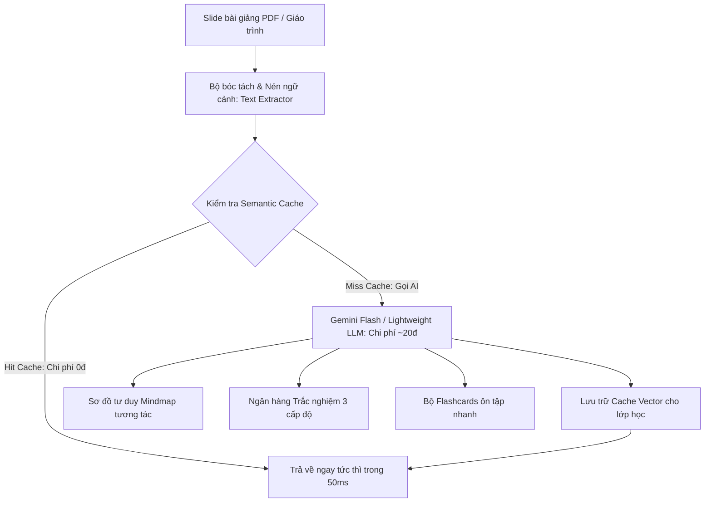

# 🎓 ĐỀ ÁN Ý TƯỞNG DỰ THI HACKATHON SGU 2026
# EDUMIND LITE – NỀN TẢNG SỐ HÓA HỌC LIỆU THÔNG MINH & TẠO SƠ ĐỒ TƯ DUY TƯƠNG TÁC CHI PHÍ SIÊU THẤP

> **Đơn vị tổ chức:** BCH Đoàn Khoa Công nghệ Thông tin – Trường Đại học Sài Gòn  
> **Chủ đề dự thi:** *AI - Kỷ nguyên vươn mình: Ứng dụng AI sáng tạo, tiết kiệm chi phí vào học tập, dạy học thông minh*  
> **Tên đội thi:** **SingleNode** (Thí sinh độc lập)  
> **Tên dự án:** **EduMind Lite**  
> **Khẩu hiệu (Slogan):** *“Tải 1 slide – Học trọn 1 môn: Số hóa học liệu thông minh với chi phí chỉ 20 đồng/bài”*  
> **Tên file nộp bài:** `SingleNode_EduMindLite.pdf`  
> **Cú pháp chuyển khoản lệ phí:** `SINGLENODE - NOPLEPHITHIHACKATHON2026`

---

## 📌 I. BỐI CẢNH & TÍNH CẤP THIẾT CỦA BÀI TOÁN

Trong kỷ nguyên số, sinh viên và giảng viên tại các trường đại học đang đối mặt với những nghịch lý lớn trong học tập:
1. **Quá tải thông tin nhưng tiếp thu thụ động:** Mỗi môn học có hàng chục slide bài giảng từ 50 - 100 trang PDF chứa đầy văn bản khô khan. Sinh viên đọc trước bài thường mất tập trung, khó xâu chuỗi mối liên hệ giữa các khái niệm phức tạp (ví dụ: các giải thuật đồ thị, mô hình CSDL, kiến trúc mạng máy tính).
2. **Rào cản chi phí AI đối với sinh viên:** Các công cụ AI cao cấp hiện nay (ChatGPT Plus, Claude Pro) có giá 20 USD/tháng (~500.000 VNĐ) – một khoản chi phí quá lớn đối với đa số sinh viên. Khi ném cả file tài liệu đồ sộ lên API thương mại, chi phí token tiêu tốn rất nhanh.
3. **Nỗi lo ngân sách của Nhà trường:** Các trường đại học muốn ứng dụng AI vào cổng học tập trực tuyến (LMS) nhưng lo ngại chi phí máy chủ và hạn mức token API khổng lồ nếu hàng nghìn sinh viên cùng truy vấn mỗi ngày.

---

## 💡 II. ĐỘT PHÁ CÔNG NGHỆ: "SÁNG TẠO & TIẾT KIỆM CHI PHÍ"

**EduMind Lite** giải quyết bài toán trên bằng cách kết hợp **Mô hình ngôn ngữ thế hệ mới (Lightweight LLM)** với các kỹ thuật tối ưu hóa chi phí hàng đầu:

### 1. Nén ngữ cảnh thông minh (Context Compression - Tiết kiệm 85% token):
- Thay vì gửi toàn bộ 50 trang PDF với các đoạn văn bản dư thừa vào mô hình AI, bộ bóc tách nội dung (Text Extractor) của EduMind Lite tự động lọc các từ khóa cốt lõi, công thức, định lý và phân đoạn bài giảng thành các đơn vị tri thức (Knowledge Units).
- Chi phí xử lý toàn bộ một chương slide chỉ mất khoảng **0.0008 USD (~20 VNĐ)**.

### 2. Semantic Caching (Hỏi 1 lần – Cả lớp dùng chung với chi phí 0đ):
- Trong cùng một lớp học môn CNTT, hàng chục sinh viên thường có xu hướng hỏi các thắc mắc tương tự nhau.
- Hệ thống tích hợp lớp đệm ngữ nghĩa (**Semantic Cache**): Khi sinh viên A hỏi một khái niệm hoặc sinh bộ câu hỏi, kết quả được lưu trữ dạng vector. Khi sinh viên B hỏi nội dung tương đương, hệ thống trả về kết quả trong **0.05 giây mà tốn đúng 0 đồng tiền API**.

### 3. Đa dạng hóa trải nghiệm học tập đa giác quan (Interactive EdTech):
- **Sơ đồ tư duy tương tác (Interactive Mindmap):** Trực quan hóa cấu trúc bài học thành các nhánh tri thức có thể phóng to, thu nhỏ, kéo thả.
- **Tự động sinh trắc nghiệm 3 cấp độ:** Nhận biết – Thông hiểu – Vận dụng, chấm điểm ngay lập tức kèm giải thích cặn kẽ vì sao chọn đáp án đó.
- **Thẻ nhớ Flashcard lật 2 mặt:** Giúp sinh viên ôn tập nhanh thuật ngữ trước giờ thi.

---

## ⚙️ III. BA TÍNH NĂNG CỐT LÕI (CORE FEATURES)

### 1. Interactive Mindmap (Sơ đồ tư duy trực quan):
- Biến các khái niệm trừu tượng thành cây sơ đồ tri thức có cấu trúc logic phân tầng: Chủ đề chính $\rightarrow$ Các phân hệ $\rightarrow$ Chi tiết công thức / giải thuật.
- Người học có thể nhấp vào từng nút để xem tóm tắt chi tiết mà không cần lật lại 50 trang slide.

### 2. Smart Quiz Generator (Trắc nghiệm thông minh):
- Tự động sinh các câu hỏi trắc nghiệm sát với nội dung trọng tâm bài học của giảng viên.
- Chế độ làm bài thi thử (Mock Exam) bấm giờ và chấm điểm tự động. Giải thích chi tiết đáp án sai nhằm lấp lỗ hổng kiến thức.

### 3. Cost-Optimization Dashboard (Minh bạch chi phí):
- Hiển thị trực quan số lượng token đã tiết kiệm, tỷ lệ trúng Cache (Cache Hit Rate), và số tiền nhà trường/sinh viên đã tiết kiệm được tính theo VNĐ.

---

## 🛠️ IV. KIẾN TRÚC KỸ THUẬT (TECH STACK)

| Thành phần | Công nghệ sử dụng | Lý do lựa chọn (Tối ưu cho Solo Dev & 24h) |
| :--- | :--- | :--- |
| **Frontend** | React / Vite, Vanilla CSS, Lucide Icons | Xây dựng giao diện học tập hiện đại, mượt mà, tối ưu trải nghiệm người dùng, tải cực nhanh. |
| **Mindmap Visualizer** | SVG Tree Engine / Canvas tương tác | Trực quan hóa sơ đồ tư duy dạng node phân nhánh kéo thả sinh động. |
| **Backend API** | Python FastAPI, Uvicorn | Xử lý file PDF nhanh chóng, bất đồng bộ cao, cấu trúc RESTful chuẩn mực. |
| **AI Engine** | Gemini 1.5 Flash API + Structured JSON Mode | Xử lý hàng chục nghìn token trong 1-2 giây, chi phí rẻ nhất thế giới, định dạng JSON chuẩn 100%. |
| **Semantic Cache** | In-memory Vector Index & Cosine Similarity | Triển khai nhanh trong 24h, không phụ thuộc hạ tầng đám mây đắt tiền, chứng minh cơ chế 0đ cho câu hỏi lặp lại. |

---

## 🎬 V. KỊCH BẢN DEMO THUYẾT PHỤC TRƯỚC BAN GIÁM KHẢO (3 PHÚT)

1. **Phút 0:00 - 0:45 | Khởi đầu ấn tượng:**  
   Trình bày thực trạng: *“Thầy cô soạn slide 80 trang rất tâm huyết nhưng sinh viên đọc 10 trang là buồn ngủ. Dùng ChatGPT thì tốn 500k/tháng. Hôm nay em giới thiệu EduMind Lite.”*
2. **Phút 0:46 - 2:00 | Trực tiếp thao tác (Live Demo 3 bước):**  
   - Chọn sẵn 1 slide môn *Cấu trúc dữ liệu & Giải thuật* của trường ĐH Sài Gòn.
   - Bấm **"Chuyển Đổi Bài Học"** $\rightarrow$ Sau 2 giây, hiện ra ngay:
     * Cây **Sơ đồ tư duy (Mindmap)** phân nhánh rõ ràng giữa Danh sách liên kết, Cây nhị phân và Đồ thị.
     * Chuyển tab **Trắc nghiệm**: Mời thầy cô chọn thử 1 câu $\rightarrow$ Hệ thống chấm điểm và nổ pháo hoa chúc mừng.
     * Đồng hồ chi phí: *“Tổng chi phí xử lý bài học này: 24 VNĐ!”*
3. **Phút 2:01 - 3:00 | Minh họa Semantic Cache & Kết luận:**  
   - Bấm yêu cầu tạo lại câu hỏi tương tự lần 2 $\rightarrow$ Màn hình hiện xanh lá: *“Hit Semantic Cache! Trả lời trong 0.04s – Chi phí: 0 VNĐ!”*
   - Khẳng định giá trị nhân văn: Giúp sinh viên bình dân tiếp cận AI giáo dục chất lượng cao với chi phí gần như bằng 0.
