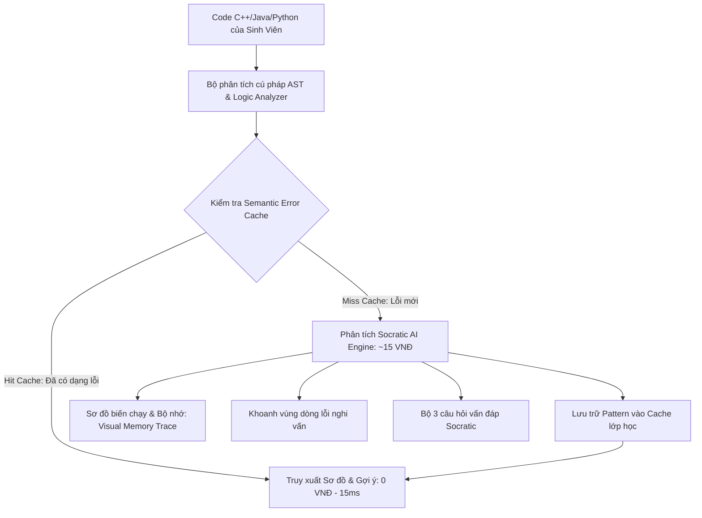

# 💻 ĐỀ ÁN Ý TƯỞNG DỰ THI HACKATHON SGU 2026
# SOCRATICCODE AI – TRỢ GIẢNG GỢI MỞ TƯ DUY LẬP TRÌNH & TRỰC QUAN HÓA BỘ NHỚ SIÊU TIẾT KIỆM

> **Đơn vị tổ chức:** BCH Đoàn Khoa Công nghệ Thông tin – Trường Đại học Sài Gòn  
> **Chủ đề dự thi:** *AI - Kỷ nguyên vươn mình: Ứng dụng AI sáng tạo, tiết kiệm chi phí vào học tập, dạy học thông minh*  
> **Tên đội thi:** **SingleNode** (Thí sinh độc lập)  
> **Tên dự án:** **SocraticCode AI**  
> **Khẩu hiệu (Slogan):** *“Nhìn thấy bug – Hiểu bản chất – Nói KHÔNG với chép code thụ động”*  
> **Tên file nộp bài:** `SingleNode_SocraticCodeAI.pdf`  
> **Cú pháp chuyển khoản lệ phí:** `SINGLENODE - NOPLEPHITHIHACKATHON2026`

---

## 📌 I. BỐI CẢNH & "NỖI ĐAU THẾ KỶ" CỦA SINH VIÊN & GIẢNG VIÊN CNTT

Sự bùng nổ của các mô hình ngôn ngữ lớn (ChatGPT, Claude, GitHub Copilot) đang đẩy việc đào tạo lập trình tại các trường đại học vào một cuộc khủng hoảng tư duy nghiêm trọng:
1. **Thói quen chép code thụ động (Copy-Paste Syndrome):** Khi sinh viên năm 1, năm 2 học các môn nền tảng như *Lập trình C/C++, Kỹ thuật Lập trình, Cấu trúc Dữ liệu & Giải thuật*, mỗi khi gặp bug hoặc bài tập khó, sinh viên thường ném cả đề bài vào ChatGPT. AI viết sẵn 100% mã nguồn hoàn chỉnh $\rightarrow$ Sinh viên chép nộp bài $\rightarrow$ **Không hiểu bản chất, không rèn luyện được tư duy giải thuật, và rớt môn hàng loạt khi bước vào phòng thi viết code trên giấy!**
2. **Nỗi trăn trở của Giảng viên:** Thầy cô Khoa CNTT cực kỳ đau đầu vì không thể cấm sinh viên dùng AI, nhưng dùng AI hiện tại lại triệt tiêu tính sáng tạo và khả năng tự gỡ lỗi (debugging) của sinh viên.
3. **Chi phí gia sư đắt đỏ:** Thuê gia sư/trợ giảng hỗ trợ 1:1 gỡ lỗi lúc nửa đêm là điều bất khả thi về mặt chi phí đối với phần lớn sinh viên.

---

## 💡 II. ĐỘT PHÁ CÔNG NGHỆ: TẠI SAO SOCRATICCODE AI KHÔNG PHẢI CHATGPT WRAPPER?

**SocraticCode AI** được thiết kế như một **Trợ giảng sư phạm thông minh**, giải quyết triệt để vấn đề trên bằng 3 trụ cột kỹ thuật:

### 1. Phương pháp Socratic (Vấn đáp gợi mở - Tuyệt đối KHÔNG giải hộ):
- Khi sinh viên nộp đoạn code bị lỗi, hệ thống **tuyệt đối không bao giờ viết lại code hoàn chỉnh**.
- Thay vào đó, AI phân tích cú pháp (AST) và logic, khoanh vùng **dòng code nghi vấn**, và đưa ra **3 câu hỏi gợi mở tư duy** dẫn dắt sinh viên từng bước tự tìm ra nguyên nhân và tự tay sửa lại bài.

### 2. Trực quan hóa bộ nhớ & Biến chạy (Visual Execution & Memory Trace):
- *ChatGPT chỉ trả về văn bản khô khan, sinh viên không hình dung được máy tính đang chạy thế nào.*
- **SocraticCode AI** mô phỏng và **vẽ trực quan sơ đồ các ô nhớ**:
  - Trạng thái biến thay đổi qua từng bước lặp (Trace Table).
  - Vị trí con trỏ trỏ sai vùng nhớ (Segmentation Fault / Dangling Pointer).
  - Biên mảng bị truy cập vượt giới hạn (Off-by-one / Buffer Overflow).
- Giúp sinh viên **"nhìn thấy bug bằng mắt"** thay vì đoán mò.

### 3. Semantic Error Caching (Tiết kiệm 95% chi phí API cho nhà trường):
- Trong cùng một khóa học, hàng trăm sinh viên thường mắc các lỗi kinh điển giống hệt nhau (ví dụ: *quên điều kiện dừng đệ quy, nhầm lẫn giữa con trỏ và giá trị, vòng lặp nhị phân bị kẹt vô tận*).
- **Hệ thống Semantic Caching:** Lưu trữ vector các dạng lỗi phổ biến. Khi sinh viên gặp lỗi tương tự, hệ thống đối soát độ tương đồng và trả về sơ đồ hướng dẫn trong **0.02 giây với chi phí ĐÚNG 0 ĐỒNG**, giúp nhà trường tiết kiệm hàng chục triệu tiền API.

---

## ⚙️ III. BA TÍNH NĂNG CỐT LÕI (CORE FEATURES)

### 1. Trình Gỡ Lỗi Trực Quan (Interactive Visual Debugger):
- Trình soạn thảo code tích hợp hiển thị dòng code lỗi bằng đèn cảnh báo vàng/đỏ.
- Bảng theo dõi trạng thái biến (Variables Watcher) cập nhật trực quan theo từng vòng lặp.

### 2. Chế độ Vấn Đáp Socratic (Socratic Guided Assistant):
- Đưa ra các gợi ý định hướng:
  * *Quan sát:* "Hãy nhìn giá trị của biến `mid` ở vòng lặp thứ 3..."
  * *Thách thức:* "Nếu `left` bằng `right`, điều kiện `left < right` có còn tiếp tục chạy không?"
  * *Hành động:* "Bạn hãy thử thay đổi điều kiện cập nhật để xem kết quả thay đổi thế nào!"

### 3. Bảng Đối Soát Hiệu Quả Tư Duy:
- So sánh trực quan giữa:
  - ❌ **Chế độ ChatGPT truyền thống:** Copy code $\rightarrow$ Điểm tư duy: 0/100 $\rightarrow$ Dễ trượt môn.
  - ✅ **Chế độ SocraticCode AI:** Tự gỡ lỗi $\rightarrow$ Điểm hiểu bản chất: 100/100 $\rightarrow$ Làm chủ giải thuật.

---

## 🛠️ IV. KIẾN TRÚC KỸ THUẬT (TECH STACK)

| Thành phần | Công nghệ sử dụng | Lý do lựa chọn (Tối ưu cho Solo Dev & 24h) |
| :--- | :--- | :--- |
| **Frontend IDE UI** | React, Vite, Vanilla CSS, Lucide Icons | Giao diện Dark-mode phong cách VS Code chuyên nghiệp, tải siêu nhanh, hỗ trợ gõ code trực tiếp. |
| **Visual Memory Engine** | React State & Dynamic Memory Blocks | Vẽ trực quan các khối ô nhớ (Stack, Heap, Pointers, Arrays) mượt mà trên trình duyệt. |
| **Backend AI Gateway** | Python FastAPI, Uvicorn | Xử lý code parser nhanh chóng, tích hợp phân tích cấu trúc logic. |
| **Socratic Reasoning Model** | Gemini 1.5 Flash (Structured Prompting) | Phân tích lỗi logic và sinh câu hỏi sư phạm với chi phí siêu rẻ (~15 đồng/lần). |
| **Semantic Error Cache** | Vector Similarity Indexing (In-Memory) | Tái sử dụng lời giải thích cho các lỗi lập trình kinh điển cùng môn học với giá 0đ. |

---

## 🎬 V. KỊCH BẢN DEMO "ĐƯỢC LÒNG 100% THẦY CÔ CNTT" (3 PHÚT)

1. **Phút 0:00 - 0:45 | Đánh trúng nỗi đau:**  
   Chiếu slide nêu vấn nạn: *“Sinh viên nộp bài tập C++ 10 điểm nhờ ChatGPT, nhưng thi cuối kỳ trên giấy chỉ được 2 điểm vì không biết tự viết 1 dòng code. SocraticCode AI ra đời để cứu vãn tư duy lập trình!”*
2. **Phút 0:46 - 2:00 | Live Demo gỡ lỗi trực tiếp:**  
   - Chọn bài toán kinh điển: *Thuật toán Tìm kiếm Nhị phân (Binary Search) bị lỗi vòng lặp vô tận (Infinite Loop)*.
   - Bấm nút **"Phân Tích Bằng SocraticCode"**:
     * Màn hình highlight ngay dòng 12: `left = mid;` (thay vì `mid + 1`).
     * Bên cạnh hiện ra **Sơ đồ biến chạy**: Thấy rõ `left=2, right=3, mid=2` lặp đi lặp lại không bao giờ thoát!
     * AI không sửa code, mà đặt câu hỏi: *“Nếu mảng chỉ còn 2 phần tử, phép chia `mid = (left + right) / 2` sẽ luôn bằng `left`, vậy làm sao `left` tăng lên được?”*
   - Bạn gõ sửa thành `left = mid + 1;` $\rightarrow$ Chương trình báo xanh: *“Chúc mừng! Bạn đã tự gỡ được bug!”*
3. **Phút 2:01 - 3:00 | Minh họa Tiết kiệm chi phí & Phản biện:**  
   - Thao tác lại lỗi đó lần 2 $\rightarrow$ Báo xanh: *“Semantic Error Cache Hit: 0 VNĐ!”*.
   - Khẳng định: Đây là công cụ đào tạo sư phạm chân chính, phụng sự nền tảng giáo dục của Đại học Sài Gòn!
