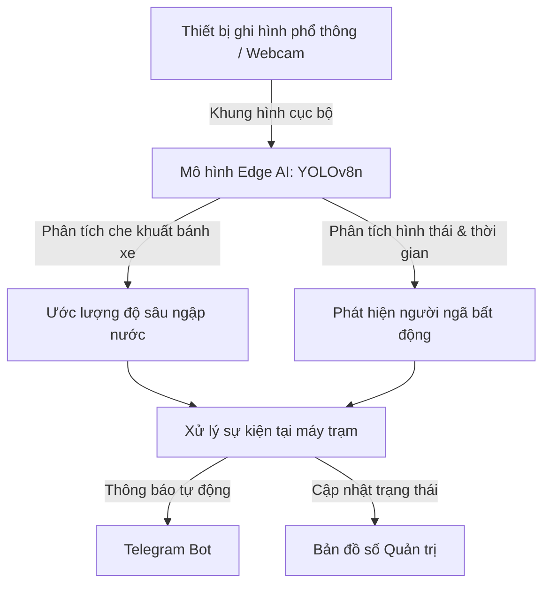

# 🛡️ ĐỀ ÁN Ý TƯỞNG DỰ THI HACKATHON SGU 2026
# URBANSHIELD LITE – HỆ THỐNG THEO DÕI NGẬP NƯỚC & TAI NẠN BẰNG AI BIÊN CHI PHÍ THẤP

> **Đơn vị tổ chức:** BCH Đoàn Khoa Công nghệ Thông tin – Trường Đại học Sài Gòn  
> **Chủ đề dự thi:** *Ứng dụng AI sáng tạo, tiết kiệm chi phí vào giải pháp an toàn đô thị hoặc cuộc sống thường ngày*  
> **Tên đội thi:** **SingleNode**  
> **Tên dự án:** **UrbanShield Lite**  
> **Mục tiêu đề án:** *Ứng dụng mô hình AI biên chi phí thấp vào theo dõi ngập nước và hỗ trợ cảnh báo sự cố giao thông.*  
> **Tên file nộp bài:** `SingleNode_UrbanShieldLite.pdf`  
> **Cú pháp chuyển khoản lệ phí:** `SINGLENODE - NOPLEPHITHIHACKATHON2026`

---

## 📌 I. BỐI CẢNH & TÍNH CẤP THIẾT CỦA BÀI TOÁN

Tại các đô thị lớn như TP. Hồ Chí Minh, mật độ phương tiện xe máy cao kết hợp đặc thù địa hình trũng thấp dẫn đến hai vấn đề thường gặp:
1. **Tình trạng ngập nước cục bộ mùa mưa và triều cường:** Nước ngập sâu khiến nhiều phương tiện bị chết máy, gây ách tắc giao thông và tiềm ẩn rủi ro cho người đi đường.
2. **Sự cố ngã xe ban đêm tại khu vực vắng người:** Các vụ va chạm hoặc trượt ngã xe máy trong ngõ xóm vào ban đêm có thể không được phát hiện kịp thời để sơ cứu hoặc hỗ trợ y tế.

### 🛑 Hạn chế của các giải pháp hiện nay:
- Các hệ thống camera AI chuyên dụng thường có giá thành cao, đòi hỏi máy chủ GPU tập trung để giải mã luồng video liên tục.
- Chi phí đường truyền và duy trì băng thông lớn cho nhiều luồng camera khiến việc mở rộng đến các tuyến đường nhánh và khu dân cư gặp khó khăn về ngân sách.

---

## 💡 II. ĐỀ XUẤT GIẢI PHÁP: ỨNG DỤNG EDGE AI TIẾT KIỆM CHI PHÍ

**UrbanShield Lite** tiếp cận bài toán bằng việc ứng dụng mô hình **Trí tuệ nhân tạo biên (Edge AI)** nhỏ gọn, giúp giảm chi phí đầu tư phần cứng và vận hành:

### 1. Tận dụng phần cứng phổ thông sẵn có:
- Có khả năng hoạt động trên các thiết bị ghi hình phổ thông, webcam hoặc máy tính sẵn có tại khu dân cư.
- Sử dụng mô hình thị giác máy tính rút gọn (**YOLOv8-nano**) được tối ưu hóa để chạy trực tiếp trên vi xử lý CPU thông thường mà không bắt buộc trang bị card đồ họa rời.

### 2. Giảm thiểu băng thông đường truyền & lưu trữ:
- Thiết bị biên phân tích hình ảnh trực tiếp tại chỗ, không cần truyền luồng video liên tục 24/7 về máy chủ.
- Khi phát hiện sự cố (ngập nước hoặc người ngã xe), hệ thống mới gửi gói tin thông báo dữ liệu nhỏ (Alert Metadata gồm tọa độ, thời gian và 1 ảnh chụp hiện trường).

### 3. Phương thức truyền nhận thông báo tự động:
- Gửi thông báo sự cố qua **Telegram Bot API** và hiển thị vị trí trên **Bản đồ số nguồn mở (OpenStreetMap/Leaflet)** nhằm giảm chi phí sử dụng dịch vụ trung gian.

---

## ⚙️ III. CÁC TÍNH NĂNG ĐỀ XUẤT

### 1. Ước lượng mức độ ngập nước (Water Depth Estimation):
- Mô hình nhận diện phương tiện xe máy di chuyển qua khu vực có nước.
- Dựa trên đường kính tiêu chuẩn của bánh xe máy (~50cm), thuật toán tính tỷ lệ che khuất của mặt nước để phân loại các mức độ:
  - 🟢 **Mức 1 (Bình thường):** Dưới 10cm (mặt đường chỉ xăm xắp nước).
  - 🟡 **Mức 2 (Mức chú ý):** 10 - 20cm (nước chạm mép ống xả xe máy).
  - 🔴 **Mức 3 (Mức cảnh báo sâu):** > 20cm (nguy cơ chết máy phương tiện).

### 2. Hỗ trợ phát hiện người ngã xe ban đêm (Fall Detection):
- Mô hình phân tích tương quan giữa đối tượng `người` và `xe máy`.
- Khi phát hiện tư thế người nằm ngang trên mặt đường (Width / Height > 1.3) và giữ nguyên trạng thái liên tục quá 5 giây:
  - Kích hoạt thông báo sự cố.
  - Gửi ảnh chụp hiện trường kèm tọa độ qua Telegram đến người phụ trách.

### 3. Bản đồ theo dõi trực quan (Safety Map Concept):
- Giao diện web hiển thị vị trí các điểm giám sát trên nền bản đồ mở.
- Cập nhật trạng thái ngập nước và cảnh báo sự cố theo thời gian thực.

---

## 🛠️ IV. KIẾN TRÚC KỸ THUẬT (TECH STACK)

| Thành phần | Công nghệ sử dụng | Lý do lựa chọn |
| :--- | :--- | :--- |
| **Edge AI Engine** | Python, `ultralytics` (YOLOv8n), OpenCV | Mô hình nhỏ gọn (~6.5MB), chạy được trên CPU máy tính phổ thông không cần GPU rời. |
| **Backend API** | FastAPI, Uvicorn, WebSockets | Xử lý bất đồng bộ gọn nhẹ, phản hồi nhanh. |
| **Frontend Dashboard** | React / Vite, Clean CSS | Giao diện quản trị rõ ràng, tương phản tốt, dễ theo dõi. |
| **Bản đồ số** | Leaflet.js / OpenStreetMap | Nguồn mở, linh hoạt, không phát sinh chi phí bản quyền API. |
| **Kênh thông báo** | Telegram Bot API | Dễ tích hợp, hỗ trợ gửi kèm ảnh và tọa độ vị trí. |

---

## 🎬 V. KỊCH BẢN THUYẾT TRÌNH Ý TƯỞNG 3 PHÚT (PITCHING OUTLINE)

1. **Phút 0:00 - 0:45 | Đặt vấn đề thực tế & Rào cản chi phí:**  
   Nêu thực trạng ngập nước cục bộ gây chết máy xe và các vụ ngã xe ban đêm khó được phát hiện kịp thời tại khu vực vắng người. Nêu rõ rào cản chi phí khi muốn mở rộng camera AI truyền thống.
2. **Phút 0:46 - 2:00 | Ý tưởng giải pháp & Phương pháp kỹ thuật:**  
   - **Ước lượng độ sâu qua bánh xe:** Dựa vào đường kính tiêu chuẩn bánh xe máy để tính tỷ lệ che khuất $\rightarrow$ Cảnh báo mức nước cho người đi đường.
   - **Phát hiện người ngã xe:** Phân tích tỷ lệ khung hình ngang kết hợp kiểm tra bất động 5 giây nhằm giảm cảnh báo nhầm $\rightarrow$ Gửi thông tin qua Telegram.
3. **Phút 2:01 - 3:00 | Tính khả thi & Bảo vệ quyền riêng tư:**  
   Trình bày ưu điểm của xử lý cục bộ: Tận dụng phần cứng sẵn có, giảm tải băng thông và chỉ lưu trữ hình ảnh khi có sự kiện để bảo vệ quyền riêng tư người dân.
