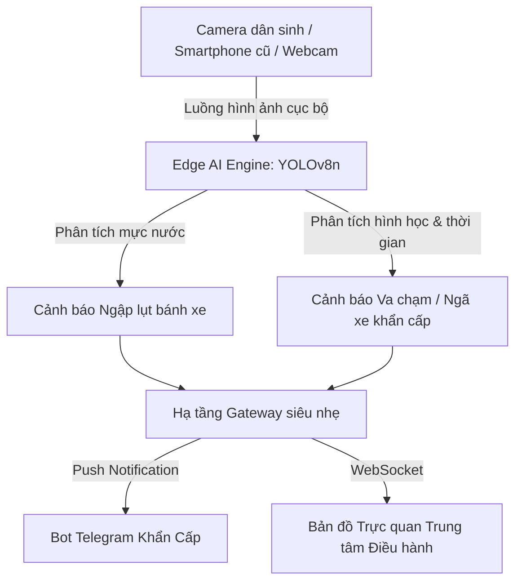

# 🛡️ ĐỀ ÁN Ý TƯỞNG DỰ THI HACKATHON SGU 2026
# URBANSHIELD LITE – HỆ THỐNG GIÁM SÁT NGẬP LỤT & AN TOÀN ĐÔ THỊ BẰNG EDGE AI TIẾT KIỆM CHI PHÍ

> **Đơn vị tổ chức:** BCH Đoàn Khoa Công nghệ Thông tin – Trường Đại học Sài Gòn  
> **Chủ đề dự thi:** *Ứng dụng AI sáng tạo, tiết kiệm chi phí vào giải pháp an toàn đô thị hoặc cuộc sống thường ngày*  
> **Tên đội thi:** **SingleNode**  
> **Tên dự án:** **UrbanShield Lite**  
> **Khẩu hiệu (Slogan):** *“Mạng lưới thị giác AI phân tán – Giữ an toàn từng góc phố Sài Gòn”*  
> **Tên file nộp bài:** `SingleNode_UrbanShieldLite.pdf`  
> **Cú pháp chuyển khoản lệ phí:** `SINGLENODE - NOPLEPHITHIHACKATHON2026`

---

## 📌 I. BỐI CẢNH & TÍNH CẤP THIẾT CỦA BÀI TOÁN

Thành phố Hồ Chí Minh là đô thị đặc biệt với mật độ giao thông xe máy dày đặc nhất cả nước và đặc thù địa hình trũng thấp, thường xuyên đối mặt với hai vấn nạn kinh niên:
1. **Ngập lụt đô thị mùa triều cường và mưa lớn:** Nước ngập sâu bất ngờ khiến hàng nghìn phương tiện chết máy, gây tê liệt giao thông và nguy cơ tai nạn sụp hố ga, rò rỉ điện.
2. **Tai nạn giao thông và sự cố đêm khuya:** Nhiều vụ va chạm, ngã xe máy trên các tuyến đường vắng hoặc ngõ hẻm vào ban đêm không được phát hiện kịp thời, làm lỡ "thời gian vàng" cứu hộ y tế.

### 🛑 Nút thắt của các giải pháp hiện nay:
- Các hệ thống "Thành phố thông minh" (Smart City) hiện tại cực kỳ đắt đỏ, đòi hỏi camera AI chuyên dụng hàng chục triệu đồng mỗi chiếc và hạ tầng máy chủ GPU công suất lớn để phân tích luồng video tập trung.
- Chi phí đường truyền băng thông truyền phát (streaming) hàng nghìn luồng camera về trung tâm là rào cản tài chính khổng lồ khiến việc phủ sóng an toàn đến các ngõ xóm dân cư là bất khả thi.

---

## 💡 II. GIẢI PHÁP ĐỘT PHÁ: "TIẾT KIỆM CHI PHÍ BẰNG EDGE AI"

**UrbanShield Lite** giải quyết bài toán trên bằng mô hình **Trí tuệ nhân tạo biên (Edge AI)** siêu nhẹ, mang lại hiệu quả vượt trội với chi phí đầu tư gần như bằng 0:

### 1. Tận dụng phần cứng giá rẻ sẵn có (Tái chế thiết bị):
- Hoạt động mượt mà trên **camera dân sinh 200.000 VNĐ, webcam phổ thông, hoặc điện thoại thông minh cũ** của người dân/tổ dân phố.
- Không đòi hỏi máy chủ GPU đắt tiền: Sử dụng mô hình thị giác máy tính siêu nhẹ (**YOLOv8-nano / MobileNet**) được tối ưu hóa để chạy trực tiếp trên CPU phổ thông hoặc trình duyệt (WebGPU).

### 2. Tiết kiệm 99% chi phí băng thông & lưu trữ:
- Camera không cần truyền stream video liên tục về máy chủ.
- Thiết bị biên chỉ xử lý cục bộ, chỉ khi phát hiện sự cố (ngập nước, ngã xe) mới gửi gói tín hiệu cảnh báo cực nhẹ (Alert Metadata: tọa độ, thời gian, 1 ảnh snapshot hiện trường).

### 3. Tận dụng hạ tầng truyền thông 0 đồng:
- Bắn cảnh báo khẩn cấp tức thời (realtime) qua **Telegram Bot API** và hiển thị trên **Bản đồ web cộng đồng mã nguồn mở (OpenStreetMap/Leaflet)** mà không phát sinh bất kỳ chi phí dịch vụ bên thứ ba nào.

---

## ⚙️ III. BA TÍNH NĂNG CỐT LÕI (CORE FEATURES)

### 1. Phát hiện & Đo lường ngập lụt cục bộ (Flood Detection):
- AI nhận diện phương tiện di chuyển qua vùng nước ngập.
- Sử dụng thuật toán đo tỉ lệ che khuất của nước đối với bánh xe máy/ô tô để phân loại 3 cấp độ:
  - 🟢 **Mức 1 (An toàn):** Dưới 10cm (nước xăm xắp mặt đường).
  - 🟡 **Mức 2 (Nguy cơ):** 10 - 20cm (nước ngập nửa bánh xe máy).
  - 🔴 **Mức 3 (Báo động ngập sâu):** > 20cm (nguy cơ chết máy, khuyến cáo đổi lộ trình).

### 2. Nhận diện tai nạn & Ngã xe ban đêm (Accident & Fall Alert):
- AI phát hiện sự tương quan vị trí giữa đối tượng `người` và `xe máy`.
- Khi phát hiện xe và người nằm nghiêng/ngang trên mặt đường quá 5 giây mà không đứng dậy:
  - Hệ thống tự động kích hoạt trạng thái **SOS Khẩn cấp**.
  - Gửi ảnh chụp hiện trường + tọa độ vị trí về kênh cứu hộ/người thân qua Telegram.

### 3. Bản đồ An toàn Đô thị Thời gian thực (Live Safety Map):
- Giao diện trung tâm điều hành trực quan trên Web (thiết kế phong cách Dark-mode chỉ huy).
- Tự động hiển thị các điểm đen ngập lụt và sự cố tai nạn theo thời gian thực trên bản đồ TP.HCM.

---

## 🛠️ IV. KIẾN TRÚC KỸ THUẬT CHO VÒNG THI 24 GIỜ (TECH STACK)

| Thành phần | Công nghệ sử dụng | Lý do lựa chọn (Tối ưu cho 24h & Solo Dev) |
| :--- | :--- | :--- |
| **Edge AI Engine** | Python, `ultralytics` (YOLOv8n), OpenCV | Mô hình nhẹ nhất thế giới (~6MB), chạy 30 FPS mượt mà trên CPU laptop không cần GPU rời. |
| **Backend API** | FastAPI, Uvicorn, WebSockets | Xử lý bất đồng bộ cực nhanh, đẩy dữ liệu sự cố lên Frontend trong vài mili-giây. |
| **Frontend Dashboard** | React / Next.js / Vite, Tailwind CSS, Lucide Icons | Xây dựng giao diện trung tâm điều hành hiện đại, bắt mắt, phản hồi nhanh. |
| **Bản đồ số** | Leaflet.js / OpenStreetMap | Miễn phí 100%, không cần đăng ký thẻ tín dụng hay API Key đắt tiền của Google Maps. |
| **Hệ thống Cảnh báo** | Telegram Bot API | Triển khai trong 5 phút, miễn phí, hỗ trợ gửi kèm ảnh và định vị GPS tức thời. |

---

## 🎬 V. KỊCH BẢN THUYẾT TRÌNH Ý TƯỞNG 3 PHÚT (PITCHING OUTLINE)

1. **Phút 0:00 - 0:45 | Đặt vấn đề thực tiễn & Nút thắt chi phí:**  
   Nêu bật thực trạng ngập lụt trũng thấp gây chết máy hàng loạt và các vụ tai nạn ngõ hẻm vắng người bị lỡ "thời gian vàng" cấp cứu. Khẳng định nghịch lý: *Không phải thiếu công nghệ, mà vì camera AI truyền thống quá đắt (30 triệu/mắt + cụm server GPU đồ sộ)*.
2. **Phút 0:46 - 2:00 | Ý tưởng giải pháp & Cơ chế thị giác AI đột phá:**  
   - **Đo ngập vật lý không cảm biến:** Phân tích tỷ lệ che khuất bánh xe máy lưu thông (chuẩn 50cm) $\rightarrow$ Tính toán chính xác độ sâu cm nước $\rightarrow$ Ghim cảnh báo lên bản đồ số để người dân chuyển hướng.
   - **Phát hiện tai nạn ngã xe ban đêm:** Nhận diện tỷ lệ dáng người nằm ngang ($W/H > 1.3$) kết hợp đếm bất động ($> 5s$) để triệt tiêu báo động giả $\rightarrow$ Tự động gửi gói tin SOS kèm ảnh hiện trường qua bot Telegram về lực lượng cứu trợ.
3. **Phút 2:01 - 3:00 | Bài toán kinh tế & Khả năng nhân rộng phân tán:**  
   Trình bày so sánh TCO: Tiết kiệm 95% chi phí đầu tư nhờ tái chế phần cứng và tiết kiệm 99% băng thông nhờ điện toán biên (Edge Computing). Kết luận thông điệp: *"Một góc phố, một điểm chạm an toàn"*.
