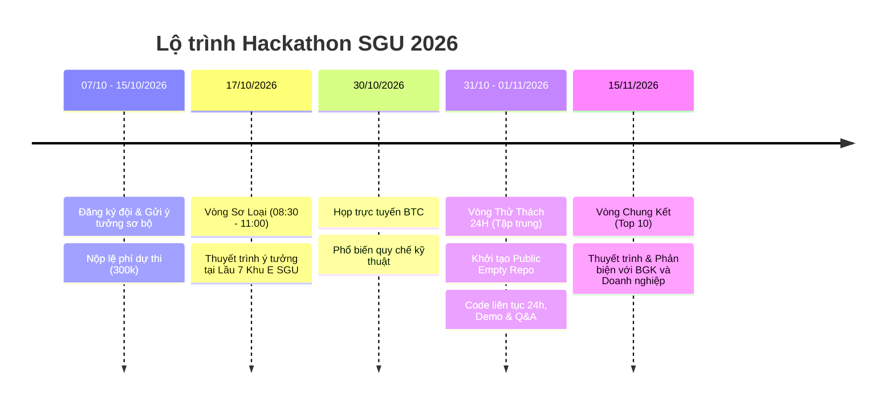

# 🚀 Hackathon SGU 2026 – AI Kỷ Nguyên Vươn Mình

Workspace lưu trữ thể lệ, ý tưởng và dự án tham dự cuộc thi **HACKATHON SGU 2026 – 2027** do BCH Đoàn Khoa Công nghệ Thông tin - Trường Đại học Sài Gòn tổ chức.

---

## 📌 1. Thông tin nhanh về cuộc thi

- **Chủ đề chính:**  
  > *"AI - KỶ NGUYÊN VƯƠN MÌNH: ỨNG DỤNG AI SÁNG TẠO, TIẾT KIỆM CHI PHÍ VÀO HỌC TẬP, DẠY HỌC THÔNG MINH, GIẢI PHÁP AN TOÀN ĐÔ THỊ HOẶC CUỘC SỐNG THƯỜNG NGÀY."*
- **Tài liệu thể lệ chi tiết:** [THE_LE_CUOC_THI.md](file:///c:/Competition/HackathonSGU2026/THE_LE_CUOC_THI.md) | [Google Doc Gốc](https://docs.google.com/document/d/1PgbiUjs3lAx1mC2_aQAIZt3utYWmxBShro1ehpxOYe4/edit?tab=t.0)
- **Quy mô đội:** Tối đa 5 thành viên / đội.
- **Lệ phí:** 300.000 VNĐ / đội (Hạn chót: 15/10/2026).

---

## ⏰ 2. Các mốc thời gian cốt lõi (Action Plan)

---

## 💡 3. Các hướng đề tài tiềm năng (Brainstorming)

### Hướng 1: Học tập & Dạy học thông minh (Smart Learning & Teaching)
- **AI Trợ lý học tập cá nhân hóa & Học nhóm chi phí thấp:** Sử dụng open-source models / API giá rẻ kết hợp RAG để tóm tắt tài liệu môn học, tạo flashcard, trắc nghiệm tương tác và lộ trình tự học.
- **AI Trợ giảng thông minh cho Giảng viên:** Tự động tạo bài tập, đề kiểm tra đa dạng đề theo ma trận kiến thức, chấm điểm và gợi ý phản hồi bài tập lập trình/tiểu luận.
- **AI hỗ trợ người học đặc thù:** Chuyển đổi bài giảng thành audio/video tương tác cho sinh viên khiếm thị, sinh viên khó khăn tiếp cận học liệu số.

### Hướng 2: Giải pháp An toàn đô thị (Urban Safety)
- **Hệ thống AI giám sát & Cảnh báo an toàn dân sinh nhẹ (Edge AI / Vision):** Phát hiện nguy cơ cháy nổ, ngập nước mùa mưa tại TP.HCM, hoặc phân tích mật độ xe cộ giảm ùn tắc quanh khu vực trường học/bệnh viện.
- **Nền tảng SOS & Cảnh báo phản ứng nhanh:** Ứng dụng di động định vị khẩn cấp tích hợp AI phát hiện sự bất thường qua giọng nói hoặc cảm biến rơi ngã.

### Hướng 3: Đời sống hàng ngày (Daily Life)
- **AI Quản lý chi tiêu & Tối ưu sinh hoạt cho Sinh viên:** Tự động phân tích hóa đơn, thói quen ăn uống, đưa ra khuyến nghị thực đơn dinh dưỡng tiết kiệm và gợi ý mua sắm thông minh.
- **Trợ lý gia đình & Sống xanh:** Ứng dụng nhắc nhở hạn sử dụng thực phẩm, tối ưu tiết kiệm điện năng sinh hoạt.

---

## ⚠️ 4. Lưu ý sống còn ở Vòng Thử Thách (24 Giờ)

> [!CAUTION]
> **Quy định Git & Quản lý Code của BTC:**
> 1. Repo GitHub nộp cho BTC **bắt buộc phải là Repo Trống (Empty Repo)** trước giờ bắt đầu.
> 2. **Tất cả thành viên trong đội** đều phải được add vào Repo và **phải có commit log hợp lệ**.
> 3. **Nghiêm cấm commit hàng loạt (bulk commit)** mã nguồn dựng sẵn từ trước. Commit log phải phản ánh đúng tiến trình làm bài trong suốt 24 giờ.
