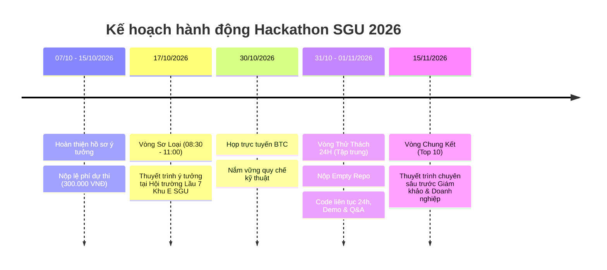

# 🎓 EduMind Lite – Nền Tảng Số Hóa Học Liệu & Tạo Sơ Đồ Tư Duy Siêu Tiết Kiệm

> **Dự án tham dự cuộc thi HACKATHON SGU 2026 – 2027**  
> **Chủ đề:** *Ứng dụng AI sáng tạo, tiết kiệm chi phí vào học tập, dạy học thông minh.*  
> **Đội thi:** **SingleNode** (Solo Developer - [nphat-code](https://github.com/nphat-code))  
> **Dự án:** **EduMind Lite**  
> **Repository:** [sgu-hackathon-2026-ai](https://github.com/nphat-code/sgu-hackathon-2026-ai)

---

## 📑 Tài liệu dự án

- 📄 **Đề án ý tưởng chi tiết (Nộp Sơ loại):** [DE_AN_Y_TUONG_EDUMIND_LITE.md](file:///c:/Competition/HackathonSGU2026/DE_AN_Y_TUONG_EDUMIND_LITE.md)
- 📋 **Thể lệ & Quy chế cuộc thi:** [THE_LE_CUOC_THI.md](file:///c:/Competition/HackathonSGU2026/THE_LE_CUOC_THI.md) | [Google Doc Gốc](https://docs.google.com/document/d/1PgbiUjs3lAx1mC2_aQAIZt3utYWmxBShro1ehpxOYe4/edit?tab=t.0)

---

## 🎯 Tổng quan giải pháp

**EduMind Lite** là nền tảng học tập thông minh giúp sinh viên và giảng viên tự động chuyển đổi các slide bài giảng và giáo trình dài thành:
1. 🧠 **Sơ đồ tư duy tương tác (Interactive Mindmap):** Cây tri thức phân nhánh trực quan, kéo thả sinh động.
2. 📝 **Bộ trắc nghiệm & Flashcards 3 cấp độ:** Nhận biết – Thông hiểu – Vận dụng, chấm điểm và giải thích tức thì.
3. 💰 **Hệ thống Semantic Caching & Nén ngữ cảnh:** Tiết kiệm 85% chi phí token API, với chi phí xử lý chỉ **~20 đồng / bài học**; câu hỏi đã có trong cache được truy xuất tức thì với giá **0 đồng**.

---

## 📅 Lộ trình tham gia cuộc thi



---

## 🛠️ Kiến trúc công nghệ (Tech Stack)

```
[ Slide PDF / Văn bản bài học ]
               │
               ▼
┌────────────────────────────────────────────────────────┐
│                   Python Backend                       │
│  • Text Extractor & Context Compression                │
│  • Semantic Cache (Vector In-Memory)                   │
│  • Gemini 1.5 Flash API (Structured JSON)              │
└──────────────────────────┬─────────────────────────────┘
                           │
             ┌─────────────┴─────────────┐
             ▼                           ▼
┌─────────────────────────┐ ┌─────────────────────────┐
│ Interactive Mindmap     │ │ Smart Quiz & Flashcard  │
│ React SVG Node Tree     │ │ Instant Grade & Review  │
└─────────────────────────┘ └─────────────────────────┘
```
