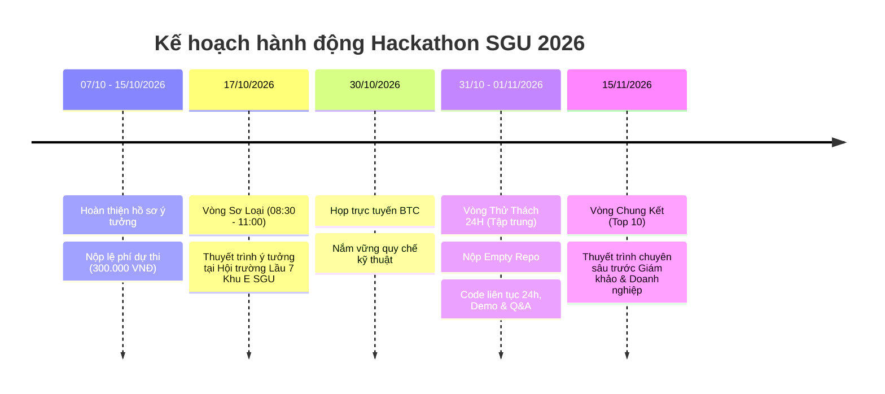

# 🛡️ UrbanShield Lite – AI Giám Sát Ngập Lụt & An Toàn Đô Thị

> **Dự án tham dự cuộc thi HACKATHON SGU 2026 – 2027**  
> **Chủ đề:** *Ứng dụng AI sáng tạo, tiết kiệm chi phí vào giải pháp an toàn đô thị hoặc cuộc sống thường ngày.*  
> **Tác giả:** Solo Developer ([nphat-code](https://github.com/nphat-code))  
> **Repository:** [sgu-hackathon-2026-ai](https://github.com/nphat-code/sgu-hackathon-2026-ai)

---

## 📑 Tài liệu dự án

- 📄 **Đề án ý tưởng chi tiết (Nộp Sơ loại):** [DE_AN_Y_TUONG_URBANSHIELD_LITE.md](file:///c:/Competition/HackathonSGU2026/DE_AN_Y_TUONG_URBANSHIELD_LITE.md)
- 📋 **Thể lệ & Quy chế cuộc thi:** [THE_LE_CUOC_THI.md](file:///c:/Competition/HackathonSGU2026/THE_LE_CUOC_THI.md) | [Google Doc Gốc](https://docs.google.com/document/d/1PgbiUjs3lAx1mC2_aQAIZt3utYWmxBShro1ehpxOYe4/edit?tab=t.0)

---

## 🎯 Tổng quan giải pháp: "Mắt thần bình dân"

**UrbanShield Lite** là hệ thống giám sát an toàn đô thị sử dụng **Edge AI siêu nhẹ**, giúp phát hiện sớm **ngập lụt đường phố** và **tai nạn / ngã xe máy ban đêm** tại TP.HCM với chi phí đầu tư gần như bằng 0.

### 🌟 Điểm nhấn "Tiết kiệm chi phí" (Cost-effective Factor):
1. **Phần cứng siêu rẻ:** Tận dụng camera an ninh dân sinh 200.000 VNĐ, webcam cũ hoặc smartphone cũ.
2. **Không cần GPU server đắt đỏ:** Sử dụng mô hình thị giác máy tính siêu nhẹ (`YOLOv8-nano` ~6MB) chạy mượt mà ngay trên CPU máy tính bình thường hoặc trình duyệt.
3. **Tiết kiệm 99% băng thông:** Thiết bị xử lý trực tiếp tại biên (Edge), chỉ đẩy dữ liệu cảnh báo nhẹ (Alert Metadata) khi xảy ra sự cố.
4. **Hạ tầng truyền thông 0 đồng:** Tích hợp cảnh báo khẩn cấp tức thời qua Telegram Bot API và bản đồ nguồn mở Leaflet / OpenStreetMap.

---

## 📅 Lộ trình tham gia cuộc thi



---

## 🛠️ Kiến trúc công nghệ 24h (Solo Tech Stack)

```
[ Camera / Video Test ]
          │
          ▼
┌───────────────────────────────────────────────┐
│              Python AI Service                │
│  • Ultralytics YOLOv8-nano (~6MB, CPU 30 FPS) │
│  • Heuristic Engine (Ngập lụt & Xe ngã)       │
│  • FastAPI + WebSockets                       │
└───────────────────────┬───────────────────────┘
                        │
          ┌─────────────┴─────────────┐
          ▼                           ▼
┌──────────────────┐        ┌──────────────────┐
│ Web Dashboard    │        │  Telegram Bot    │
│ React / Tailwind │        │  Instant Alert   │
│ Leaflet Live Map │        │  Snapshot + GPS  │
└──────────────────┘        └──────────────────┘
```

---

## ⚠️ Lưu ý kỹ thuật bắt buộc ở Vòng 24h

> [!IMPORTANT]
> - Repo nộp cho BTC trước 12:00 ngày 31/10 **bắt buộc phải là Empty Repo**.
> - Lịch sử Git log phải thể hiện rõ các commit tính năng thực tế trong suốt 24h.
> - Chuẩn bị sẵn 2 video test mẫu cục bộ trong máy (1 clip ngập lụt, 1 clip xe ngã) để đề phòng sự cố mạng WiFi trường.
