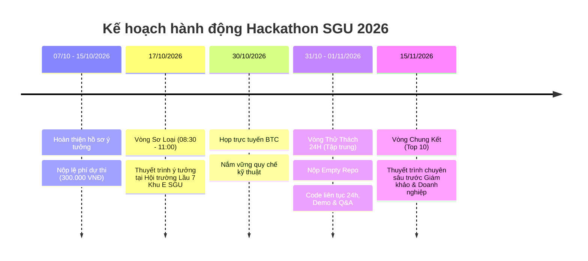

# 💻 SocraticCode AI – Trợ Giảng Gợi Mở Tư Duy Lập Trình & Trực Quan Hóa Bộ Nhớ

> **Dự án tham dự cuộc thi HACKATHON SGU 2026 – 2027**  
> **Chủ đề:** *Ứng dụng AI sáng tạo, tiết kiệm chi phí vào học tập, dạy học thông minh.*  
> **Đội thi:** **SingleNode** (Solo Developer - [nphat-code](https://github.com/nphat-code))  
> **Dự án:** **SocraticCode AI**  
> **Repository:** [sgu-hackathon-2026-ai](https://github.com/nphat-code/sgu-hackathon-2026-ai)

---

## 📑 Tài liệu dự án

- 📄 **Đề án ý tưởng chi tiết (Nộp Sơ loại):** [DE_AN_Y_TUONG_SOCRATICCODE_AI.md](file:///c:/Competition/HackathonSGU2026/DE_AN_Y_TUONG_SOCRATICCODE_AI.md)
- 📋 **Thể lệ & Quy chế cuộc thi:** [THE_LE_CUOC_THI.md](file:///c:/Competition/HackathonSGU2026/THE_LE_CUOC_THI.md) | [Google Doc Gốc](https://docs.google.com/document/d/1PgbiUjs3lAx1mC2_aQAIZt3utYWmxBShro1ehpxOYe4/edit?tab=t.0)

---

## 🎯 Tuyên ngôn giải pháp: "Nói KHÔNG với chép code giải hộ"

Khác với ChatGPT hay Copilot làm sinh viên mất dần khả năng tư duy vì copy code sẵn, **SocraticCode AI** đóng vai trò là một **Trợ giảng sư phạm thông minh**:
1. 🧠 **Phương pháp Socratic (Vấn đáp gợi mở):** Khoanh vùng chính xác dòng code nghi vấn, đặt 3 câu hỏi dẫn dắt để sinh viên tự tìm ra nguyên nhân và tự tay sửa lỗi.
2. 🔬 **Visual Memory & Execution Trace:** Trực quan hóa sơ đồ các ô nhớ, con trỏ và bảng giá trị biến chạy từng bước (nhìn thấy bug bằng mắt).
3. 💰 **Semantic Error Caching:** Tái sử dụng phân tích các lỗi lập trình kinh điển trong cùng môn học với chi phí **0 đồng** và độ trễ **15ms**.

---

## 📅 Lộ trình tham gia cuộc thi



---

## 🛠️ Kiến trúc công nghệ (Tech Stack)

```
[ Code C++ / Java / Python của Sinh viên ]
                    │
                    ▼
┌────────────────────────────────────────────────────────┐
│                   Python Backend                       │
│  • AST Code Parser & Logic Bug Detector                │
│  • Semantic Error Cache (Vector In-Memory)             │
│  • Socratic Reasoning Engine (Structured JSON)         │
└──────────────────────────┬─────────────────────────────┘
                           │
             ┌─────────────┴─────────────┐
             ▼                           ▼
┌─────────────────────────┐ ┌─────────────────────────┐
│ Code Editor & Visual    │ │ Socratic Guided Q&A     │
│ Memory/Trace Engine     │ │ Interactive Self-Fix    │
└─────────────────────────┘ └─────────────────────────┘
```
