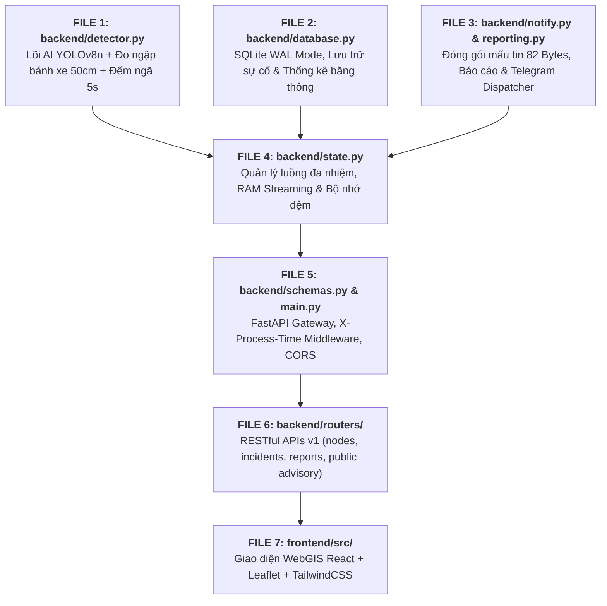

# 📖 GIẢI THÍCH CHI TIẾT MÃ NGUỒN DỰ ÁN URBANSHIELD LITE
## THEO QUY TRÌNH THỰC THI HỆ THỐNG (PIPELINE-DRIVEN CODE WALKTHROUGH)
*Tài liệu kỹ thuật giải thích chi tiết từng file, từng hàm và dòng lệnh thực tế, loại bỏ cảm tính, bám sát 100% mã nguồn dự án.*

---

## 🗺️ BẢN ĐỒ QUY TRÌNH THỰC THI (EXECUTION PIPELINE)



---

# 🧠 PHẦN 1: `backend/detector.py` — LÕI THỊ GIÁC MÁY TÍNH & HÌNH HỌC THỜI GIAN THỰC

File này là **trái tim của hệ thống**, dài 834 dòng lệnh, chịu trách nhiệm nhận từng khung hình từ camera, xử lý ảnh ban đêm, chạy mô hình YOLOv8n, tính toán mực nước ngập gián tiếp và phát hiện ngã xe chống báo giả.

---

### 1. Hàm tự động nạp cấu hình môi trường: `_load_env_if_needed()`
* **Vị trí:** Dòng `9` đến `28`
* **Đoạn code thực tế:**
```python
def _load_env_if_needed():
    """Tự động nạp cấu hình từ .env nếu có mà không phụ thuộc thư viện ngoài."""
    for candidate in [".env", os.path.join(os.path.dirname(__file__), "..", ".env"), os.path.join(os.path.dirname(__file__), ".env")]:
        if os.path.exists(candidate):
            try:
                with open(candidate, "r", encoding="utf-8") as f:
                    for line in f:
                        line = line.strip()
                        if line and not line.startswith("#") and "=" in line:
                            k, v = line.split("=", 1)
                            k = k.strip()
                            v = v.strip().strip("'").strip('"')
                            if k and k not in os.environ:
                                os.environ[k] = v
                break
            except Exception:
                pass
```
* **Giải thích chi tiết:**
  - Thay vì phụ thuộc vào thư viện ngoài `python-dotenv` (dễ gây lỗi thiếu dependency khi mang sang máy khác), hàm này tự đọc file cấu hình `.env`.
  - Quét qua 3 vị trí thư mục phổ biến để nạp các biến môi trường như `MODEL_IMGSZ`, `STREAM_FPS`, `TELEGRAM_BOT_TOKEN`.

---

### 2. Thuật toán đo ngập gián tiếp qua bánh xe: `estimate_wheel_flood_depth()`
* **Vị trí:** Dòng `31` đến `59`
* **Đoạn code thực tế:**
```python
def estimate_wheel_flood_depth(
    visible_wheel_h_px: float,
    full_wheel_h_px: float,
    wheel_diameter_cm: float = 50.0
) -> Tuple[float, str]:
    if full_wheel_h_px <= 0:
        return 0.0, "SAFE"

    visible_clamped = max(0.0, min(float(full_wheel_h_px), float(visible_wheel_h_px)))
    submerged_ratio = 1.0 - (visible_clamped / float(full_wheel_h_px))
    depth_cm = round(max(0.0, min(60.0, submerged_ratio * wheel_diameter_cm)), 1)

    if depth_cm >= 20.0:
        level = "DANGER"
    elif depth_cm >= 10.0:
        level = "WARNING"
    else:
        level = "SAFE"

    return depth_cm, level
```
* **Giải thích chi tiết:**
  - **Đầu vào:**
    - `visible_wheel_h_px`: Chiều cao pixel của phần lốp xe còn nhìn thấy được nổi trên mặt nước.
    - `full_wheel_h_px`: Chiều cao pixel của toàn bộ bánh xe (được tính gián tiếp từ thân xe máy $0.35 \times H_{\text{xe}}$).
    - `wheel_diameter_cm`: Đường kính bánh xe máy chuẩn tại Việt Nam ($50.0\text{ cm}$).
  - **Công thức tính toán:**
    $$R_{\text{chìm}} = 1.0 - \frac{h_{\text{nổi}}}{H_{\text{toàn\_bộ}}}$$
    $$\text{Độ sâu (cm)} = R_{\text{chìm}} \times 50\text{ cm}$$
  - **Phân loại ngưỡng an toàn:**
    - `depth_cm < 10.0`: Mức **SAFE** (đường ướt hoặc vũng nước nông).
    - `10.0 <= depth_cm < 20.0`: Mức **WARNING** (nước chạm mép ống xả xe tay ga).
    - `depth_cm >= 20.0`: Mức **DANGER** (ngập hơn nửa bánh xe máy, nguy cơ chết máy cực cao).

---

### 3. Phân tích rủi ro ngập theo từng loại xe: `get_vehicle_water_advisory()`
* **Vị trí:** Dòng `61` đến `158`
* **Đoạn code thực tế:**
```python
def get_vehicle_water_advisory(depth_cm: float) -> Dict[str, Any]:
    depth = max(0.0, float(depth_cm))
    # 1. Xe tay ga (Scooter: gầm 13cm, bầu lọc gió sát đất)
    if depth < 10.0:
        scooter = {"status": "SAFE", "label": "An toàn", ...}
    elif depth < 14.0:
        scooter = {"status": "WARNING", "label": "Cảnh báo ngập gầm", ...}
    else:
        scooter = {"status": "DANGER", "label": "Nguy hiểm chết máy", ...}

    # 2. Xe máy số (Underbone: gầm 16cm, cổ pô vểnh)
    if depth < 14.0:
        underbone = {"status": "SAFE", ...}
    elif depth < 20.0:
        underbone = {"status": "WARNING", ...}
    else:
        underbone = {"status": "DANGER", ...}

    # 3. Xe ô tô con (Car / Sedan: gầm 18-20cm, cửa hút gió động cơ)
    if depth < 18.0:
        car = {"status": "SAFE", ...}
    elif depth < 28.0:
        car = {"status": "WARNING", ...}
    else:
        car = {"status": "DANGER", ...}
```
* **Giải thích chi tiết:**
  - Nhận vào `depth_cm` và ánh xạ mức độ chịu nước của 3 loại xe dân sinh phổ biến nhất tại TP.HCM.
  - Cung cấp lời khuyên lái xe thực tế: *Xe ga không đi vào nếu ngập quá 13cm; xe số đi số 1-2 giữ đều ga nếu ngập 15-20cm; xe ô tô đề phòng thủy kích khi ngập trên 28cm*.

---

### 4. Bộ lọc ngã xe 4 tầng & Bộ đếm bất động 5s: `evaluate_fall_candidate()`
* **Vị trí:** Dòng `160` đến `225`
* **Đoạn code thực tế:**
```python
def evaluate_fall_candidate(
    box_w: float,
    box_h: float,
    person_center: Tuple[float, float],
    vehicle_centers: List[Tuple[float, float]],
    motionless_sec: float,
    aspect_threshold: float = 1.15,
    proximity_px: float = 180.0,
    debounce_sec: float = 5.0
) -> Dict[str, Any]:
    if box_h <= 0:
        return {"is_candidate": False, "detected": False, ...}

    # Tầng 1: Tỷ lệ khung hình W/H > 1.15 (dáng người nằm ngang)
    aspect_ratio = round(float(box_w) / float(box_h), 2)
    is_horizontal = aspect_ratio > aspect_threshold

    # Tầng 2: Vị trí tương quan với xe máy (khoảng cách < 180px và sát mặt đường)
    near_vehicle_ground = False
    min_dist = 9999.0
    for vx, vy in vehicle_centers:
        dist = float(np.hypot(person_center[0] - vx, person_center[1] - vy))
        if dist < min_dist:
            min_dist = dist
        if dist < proximity_px and person_center[1] >= (vy - 15.0):
            near_vehicle_ground = True

    # Tầng 3: Kiểm tra ứng viên
    is_candidate = is_horizontal or (aspect_ratio >= 1.05 and near_vehicle_ground)
    if not is_candidate:
        return {"is_candidate": False, "detected": False, ...}

    # Tầng 4: Bộ đếm thời gian bất động Debounce >= 5.0 giây
    elapsed = round(max(0.0, float(motionless_sec)), 1)
    if elapsed >= debounce_sec:
        return {
            "is_candidate": True,
            "detected": True,
            "motionless_sec": elapsed,
            "reason": f"Phát hiện người ngã xe nằm bất động {elapsed:.1f}s (vượt ngưỡng {debounce_sec:.0f}s, W/H={aspect_ratio})"
        }
    else:
        return {
            "is_candidate": True,
            "detected": False,
            "motionless_sec": elapsed,
            "reason": f"Đang kiểm tra bất động: {elapsed:.1f}s / {debounce_sec:.1f}s (W/H={aspect_ratio})"
        }
```
* **Giải thích chi tiết:**
  - **Tầng 1:** Dáng người đứng thẳng có tỷ lệ $\frac{W}{H} \approx 0.4 - 0.6$. Khi ngã nằm ngang, $\frac{W}{H} > 1.15$.
  - **Tầng 2:** `person_center[1] >= vy - 15.0` kiểm tra trọng tâm người có bị hạ sát mặt đường không (người ngồi trên yên xe cao hơn đáy xe nên không kích hoạt).
  - **Tầng 3:** Kết hợp tỷ lệ hình học và cự ly với xe máy đổ trong bán kính 180 pixel.
  - **Tầng 4 (Chống báo nhầm):** Nếu người dân chỉ cúi xuống nhặt đồ hoặc ngồi nghỉ rồi đứng lên trong vòng 2-3 giây, bộ đếm tự hủy. Chỉ khi nằm bất động liên tục $\ge 5.0\text{ giây}$, sự cố mới được ghi nhận.

---

### 5. Khởi tạo lớp xử lý chính: `UrbanShieldDetector.__init__()`
* **Vị trí:** Dòng `237` đến `279`
* **Đoạn code thực tế:**
```python
class UrbanShieldDetector:
    def __init__(self, model_name: str = None):
        if model_name is None:
            default_path = os.path.join(os.path.dirname(__file__), "yolov8n.pt")
            model_name = default_path if os.path.exists(default_path) else "yolov8n.pt"

        # Tối ưu hóa đa luồng CPU: Cấp 2-4 worker threads cho PyTorch
        try:
            import torch
            num_cpus = os.cpu_count() or 2
            torch.set_num_threads(max(1, min(4, num_cpus)))
        except Exception:
            pass

        self.model = YOLO(model_name)
        self.clahe = cv2.createCLAHE(clipLimit=2.0, tileGridSize=(8, 8))

        # Quản lý trạng thái độc lập cho từng trạm camera (tránh rò rỉ dữ liệu giữa 5 trạm)
        self.node_fallen_candidates: Dict[str, Dict[int, Dict[str, Any]]] = {}
        self.node_next_cand_id: Dict[str, int] = {}
        self.node_ema_depth: Dict[str, float] = {}
        self.node_last_depth: Dict[str, float] = {}
        self.node_last_time: Dict[str, float] = {}
```
* **Giải thích chi tiết:**
  - `torch.set_num_threads(...)`: Ép PyTorch tận dụng CPU đa luồng thay vì 1 luồng, giúp suy luận YOLOv8-nano trên CPU đạt ~63ms/khung hình (~28.5 FPS).
  - `self.node_fallen_candidates`: Quản lý danh sách ứng viên ngã xe theo từng trạm camera (`node_id`). Tránh việc trạm 1 ngã xe nhưng camera trạm 2 lại bị dính dữ liệu.

---

### 6. Cân bằng sáng thích ứng CLAHE cho mưa đêm: `preprocess_clahe()`
* **Vị trí:** Dòng `300` đến `315`
* **Đoạn code thực tế:**
```python
def preprocess_clahe(self, frame: np.ndarray) -> Tuple[np.ndarray, bool]:
    lab = cv2.cvtColor(frame, cv2.COLOR_BGR2LAB)
    l_chan, a_chan, b_chan = cv2.split(lab)
    l_mean = float(np.mean(l_chan))
    l_std = float(np.std(l_chan))

    # Tự động phát hiện điều kiện thiếu sáng hoặc mưa đêm lóa đèn
    if l_mean < 115.0 or l_std < 48.0:
        l_eq = self.clahe.apply(l_chan)
        merged = cv2.merge((l_eq, a_chan, b_chan))
        enhanced = cv2.cvtColor(merged, cv2.COLOR_LAB2BGR)
        return enhanced, True
    return frame, False
```
* **Giải thích chi tiết:**
  - Chuyển không gian màu sang `LAB`, trích xuất riêng kênh độ sáng $L$ (Luminance).
  - Kiểm tra độ sáng trung bình $l_{\text{mean}} < 115.0$ hoặc độ lệch chuẩn $l_{\text{std}} < 48.0$.
  - Nếu trời tối, thuật toán CLAHE sẽ chia ảnh thành các khối $8 \times 8$ và cân bằng sáng thích ứng từng khối với ngưỡng cắt `clipLimit=2.0`. Giúp nhìn rõ mép nước và lốp xe máy trong bóng tối mà không bị lóa bởi ánh đèn pha.

---

### 7. Quy trình suy luận toàn diện: `infer()`
* **Vị trí:** Dòng `342` đến `745`
* **Quy trình 5 giai đoạn liên hoàn trong hàm `infer()`:**
  1. **Chạy suy luận YOLOv8n trên CPU (Dòng 361 – 409):**
     - Đưa ảnh đã qua CLAHE vào `self.model(proc_frame, imgsz=320, conf=0.10, classes=[0, 1, 2, 3, 5, 7])`.
     - Phân loại các đối tượng: `person` (người), `motorcycle` (xe máy), `car` (xe con).
  2. **Phân loại mặt đường khô vs mặt nước (Dòng 414 – 428):**
     - Cắt vùng nửa dưới khung hình ($55\%$ chiều cao).
     - Đo độ bão hòa màu ($S$) và phương sai toán tử Laplacian ($\text{lap\_var}$).
     - Đường khô có $\text{lap\_var} > 3800.0$ (kết cấu nhựa đường sắc nét). Mặt nước phân tán ánh sáng làm mờ vân nhựa đường ($\text{lap\_var} \le 3200.0$).
  3. **Lựa chọn xe máy làm mốc đo (Dòng 431 – 469):**
     - Lọc xe máy đang di chuyển trong lòng đường: $W \ge 20\text{px}, H \ge 26\text{px}$, tỷ lệ $\frac{W}{H} \le 1.20$.
     - Kiểm tra che khuất (Occlusion Check): Xe phía trước che $>40\%$ xe phía sau sẽ bị loại bỏ để chọn ra xe mốc chuẩn nhất (`primary_ref`).
  4. **Dò mép nước bằng đạo hàm Sobel (Dòng 475 – 524):**
     - Cắt vùng lốp xe: $\text{wheel\_zone\_h} = 0.35 \times H_{\text{xe}}$.
     - Tính đạo hàm dọc Sobel: `cv2.Sobel(roi_gray, cv2.CV_64F, 0, 1, ksize=3)`.
     - Vị trí có đạo hàm lớn nhất (`peak_row`) chính là vạch ranh giới giữa lốp xe cao su đen và mặt nước đục.
     - Tính tỷ lệ chìm và gọi `estimate_wheel_flood_depth()` tính số cm ngập.
     - Dùng bộ lọc trung bình động hàm mũ EMA ($0.70 \times \text{cũ} + 0.30 \times \text{mới}$) để số đo nước không bị nhảy giật.
  5. **Bảo vệ quyền riêng tư Zero-Disk (Dòng 709 – 714):**
     - Tăng bộ đếm `self.frames_processed_in_ram += 1`.
     - Gọi lệnh `del proc_frame`, `del lower_region`, `del hsv` để giải phóng bộ nhớ ngay lập tức, **không bao giờ ghi 1 byte nào xuống ổ cứng**.
