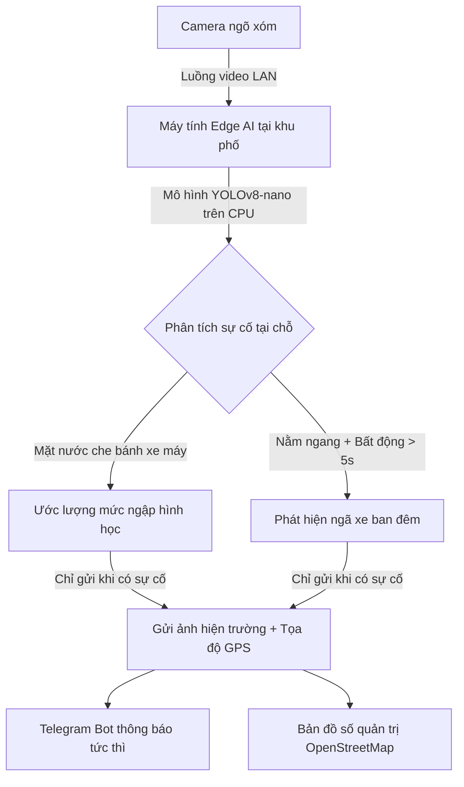

# 🛡️ TÓM TẮT SẢN PHẨM: URBANSHIELD LITE
## Hệ Thống Hỗ Trợ Theo Dõi Ngập Nước & Sự Cố Giao Thông Bằng Edge AI Chi Phí Thấp

> **Đội ngũ phát triển:** **SingleNode** ([nphat-code](https://github.com/nphat-code))  
> **Cuộc thi:** SGU Hackathon 2026 – Trường Đại học Sài Gòn  
> **Chủ đề:** AI - Kỷ nguyên vươn mình (An toàn đô thị & Dân sinh)  
> **Tài liệu tham chiếu:** [Đề án ý tưởng](file:///c:/Competition/HackathonSGU2026/docs/DE_AN_Y_TUONG_URBANSHIELD_LITE.md) | [Kịch bản thuyết trình](file:///c:/Competition/HackathonSGU2026/docs/KICH_BAN_PITCHING_URBANSHIELD_LITE.md) | [README](file:///c:/Competition/HackathonSGU2026/README.md)

---

## 📌 1. Thực Trạng Thực Tế & Rào Cản Hạ Tầng

Mỗi khi mùa mưa đến tại các đô thị lớn như TP. Hồ Chí Minh, người dân thường đối mặt với hai vấn đề nhức nhối:
1. **Ngập nước gây chết máy:** Những con đường nhỏ và ngõ hẻm hay bị ngập sâu làm phương tiện chết máy hàng loạt, cản trở giao thông và gây nguy hiểm cho người đi đường.
2. **Sự cố ngã xe ban đêm:** Vào đêm muộn, người đi xe máy bị trượt ngã ở những đoạn đường vắng thì khó được phát hiện kịp thời để giúp đỡ.

### Rào cản công nghệ hiện nay:
* **Chi phí cao:** Mua camera chuyên dụng tích hợp sẵn AI thì quá đắt đỏ để lắp khắp các ngõ xóm.
* **Nghẽn băng thông:** Nếu dùng camera thường rồi kéo video liên tục 24/7 về máy chủ trung tâm thì sẽ làm nghẽn toàn bộ đường truyền mạng và chi phí máy chủ tăng rất cao.

---

## 💡 2. Định Hướng Giải Pháp: Edge AI Chi Phí Thấp

**UrbanShield Lite** giải quyết bài toán bằng cách chuyển việc xử lý dữ liệu về máy tính ở khu phố:

* **Tận dụng phần cứng sẵn có:** Kết nối các camera ngõ xóm vào máy tính phổ thông sẵn có tại cơ sở qua mạng LAN nội bộ.
* **Xử lý trên CPU thông thường:** Chạy mô hình thị giác máy tính rút gọn **YOLOv8-nano (~6.5MB)** trực tiếp trên CPU thông thường (đạt 25 - 30 FPS), không bắt buộc phải trang bị card đồ họa rời đắt tiền.
* **Bảo vệ quyền riêng tư người dân:** Toàn bộ khung hình chỉ nạp vào bộ nhớ RAM tạm thời để phân tích và hủy ngay lập tức sau đó; không lưu trữ video vào ổ cứng và không nhận diện khuôn mặt người dân.
* **Tiết kiệm băng thông:** Máy tính ở khu phố tự phân tích tại chỗ. Chỉ khi có sự cố, hệ thống mới gửi một mẩu tin cảnh báo gọn nhẹ gồm tọa độ GPS, mốc thời gian và 1 ảnh hiện trường qua **Telegram Bot API**, giúp giảm hơn 95% băng thông mạng và tiết kiệm 70% - 80% chi phí.

---

## ⚙️ 3. Hai Tính Năng Kỹ Thuật Trọng Tâm

### 1. Ước lượng mức ngập hình học qua bánh xe máy
* Không cần lắp đặt cảm biến ngập đắt tiền hay khoan đục dưới cống.
* Thuật toán lấy đường kính chuẩn **khoảng 50cm của bánh xe máy** đang lưu thông ngoài đường làm thước đo thực tế.
* Dựa vào tỷ lệ mặt nước che bánh xe để tự động phân loại 3 mức:
  * 🟢 **Mức 1 (< 10cm):** Ngập rất nhẹ, xe di chuyển bình thường.
  * 🟡 **Mức 2 (10 - 20cm):** Nước chạm mép ống xả xe máy, cần chú ý.
  * 🔴 **Mức 3 (> 20cm):** Nguy cơ chết máy cao, cần cảnh báo để người dân tránh đi vào.

### 2. Hỗ trợ phát hiện ngã xe ban đêm (chống báo giả)
* Nhận diện đồng thời đối tượng người và xe máy.
* Áp dụng điều kiện lọc hai tầng để tránh báo nhầm (khi người dân cúi xuống nhặt đồ hoặc dắt xe):
  1. Tỷ lệ khung bao nằm ngang: $W/H > 1.15$.
  2. **Bộ đếm thời gian bất động liên tục trên 5 giây.**
* Tích hợp thuật toán cân bằng sáng thích ứng (CLAHE) giúp làm rõ chi tiết trong điều kiện ánh sáng ngõ xóm ban đêm.

---

## 🛠️ 4. Kiến Trúc Kỹ Thuật (Tech Stack)

| Thành phần | Công nghệ lựa chọn | Mục đích sử dụng |
| :--- | :--- | :--- |
| **Mô hình nhận diện** | `ultralytics` (YOLOv8n), OpenCV | Mô hình gọn nhẹ (~6.5MB), tối ưu chạy ổn định trên CPU phổ thông. |
| **Dịch vụ biên (Backend)** | Python, FastAPI, Uvicorn | Xử lý bất đồng bộ, phản hồi nhanh, tiêu thụ ít tài nguyên. |
| **Kênh cảnh báo** | Telegram Bot API | Gửi cảnh báo tức thì kèm ảnh chụp hiện trường và tọa độ sự cố. |
| **Bản đồ giám sát** | React, Vite, Leaflet, OpenStreetMap | Bảng điều khiển quản trị trực quan, hiển thị vị trí các điểm giám sát không tốn phí API. |

---

## 🎯 5. Giá Trị Thực Tiễn Cho Cộng Đồng

1. **Khả thi cao:** Tận dụng được hạ tầng máy tính và camera sẵn có tại tổ dân phố, trụ sở dân phòng hoặc nhà dân.
2. **Chi phí triển khai thấp:** Giảm thiểu chi phí đầu tư ban đầu, không tốn phí duy trì máy chủ xử lý video đồ sộ.
3. **An toàn & Riêng tư:** Thiết kế tôn trọng tuyệt đối quyền riêng tư của người dân khu phố.
4. **Hỗ trợ kịp thời:** Đưa thông tin cảnh báo ngập và sự cố đến đúng người phụ trách để có biện pháp hỗ trợ nhanh chóng.
