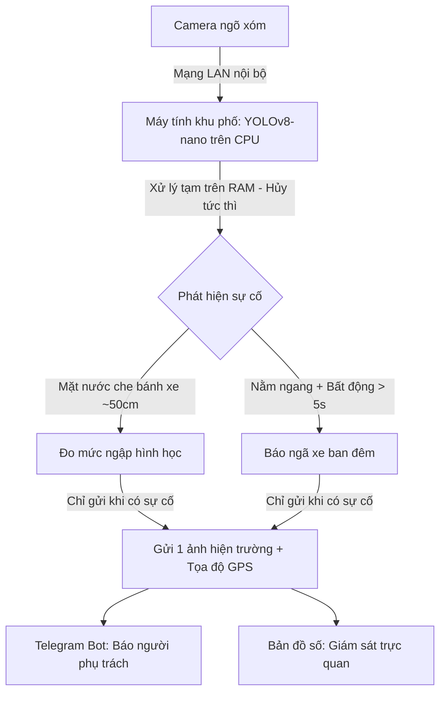

# 🛡️ TÓM TẮT SẢN PHẨM: URBANSHIELD LITE
## Hệ Thống Hỗ Trợ Theo Dõi Ngập Nước & Sự Cố Giao Thông Bằng Edge AI Chi Phí Thấp

> **Đội thi:** **SingleNode** ([nphat-code](https://github.com/nphat-code))  
> **Cuộc thi:** SGU Hackathon 2026 – ĐH Sài Gòn | **Chủ đề:** An toàn đô thị (Urban Safety)  
> **Tài liệu liên quan:** [Đề án ý tưởng](file:///c:/Competition/HackathonSGU2026/docs/DE_AN_Y_TUONG_URBANSHIELD_LITE.md) | [Slide trình chiếu](file:///c:/Competition/HackathonSGU2026/slides/SingleNode_UrbanShieldLite.pdf) | [README](file:///c:/Competition/HackathonSGU2026/README.md)

---

### ⚡ Tóm Tắt Nhanh (Đọc trong 30 giây)

* **Bài toán thực tế:** Mùa mưa đến, những con đường nhỏ và ngõ hẻm hay bị ngập sâu làm xe máy chết máy; đêm khuya trượt ngã vắng người khó được phát hiện kịp thời để giúp đỡ. Camera chuyên dụng thì quá đắt đỏ, còn kéo video liên tục về máy chủ thì làm nghẽn toàn bộ đường truyền mạng.
* **Giải pháp cốt lõi:** Tận dụng camera ngõ xóm và máy tính phổ thông sẵn có ở khu phố để chạy AI tại chỗ (**YOLOv8-nano trên CPU**, không cần card đồ họa rời).
* **2 tính năng chính:**
  1. **Đo mức ngập:** Lấy bánh xe máy (~50cm) làm thước đo hình học, tự phân loại 3 mức nước (<10cm rất nhẹ, 10-20cm chạm pô xe, >20cm nguy cơ chết máy) mà không cần cảm biến cống.
  2. **Báo ngã xe ban đêm:** Nhận diện người nằm ngang kết hợp **bộ đếm bất động > 5 giây** và thuật toán cân bằng sáng CLAHE để triệt tiêu báo giả.
* **Cơ chế vận hành:** Video nạp vào RAM xử lý xong hủy tức thì (Zero-Disk, bảo vệ quyền riêng tư). Chỉ khi có sự cố mới gửi **1 ảnh + tọa độ GPS qua Telegram Bot** và bản đồ số Leaflet (giảm hơn 95% băng thông mạng, tiết kiệm 70% - 80% chi phí).

---

### 🔄 Sơ Đồ Vận Hành

---

### 📊 Bảng So Sánh Kỹ Thuật

| Tiêu chí | Giải pháp camera truyền thống | UrbanShield Lite (SingleNode) |
| :--- | :--- | :--- |
| **Phần cứng** | Camera AI chuyên dụng / Máy chủ GPU đắt đỏ | Camera ngõ xóm + Máy tính CPU phổ thông sẵn có |
| **Đường truyền mạng** | Kéo luồng video liên tục 24/7 (dễ nghẽn mạng) | **Giảm >95% băng thông** (chỉ gửi ảnh khi có sự cố) |
| **Đo mức ngập** | Cần lắp cảm biến đo nước dưới cống | Đo hình học qua bánh xe máy (~50cm) |
| **Chống báo giả ngã xe** | Dễ báo nhầm khi người cúi nhặt đồ | Bộ đếm bất động > 5s + Thuật toán sáng ban đêm |
| **Quyền riêng tư** | Lưu trữ video dài ngày trên ổ cứng | **Zero-Disk:** Phân tích xong hủy ngay trên RAM |
| **Chi phí đầu tư** | Tốn kém chi phí thiết bị và bảo trì | **Tiết kiệm 70% - 80% chi phí** toàn hệ thống |
